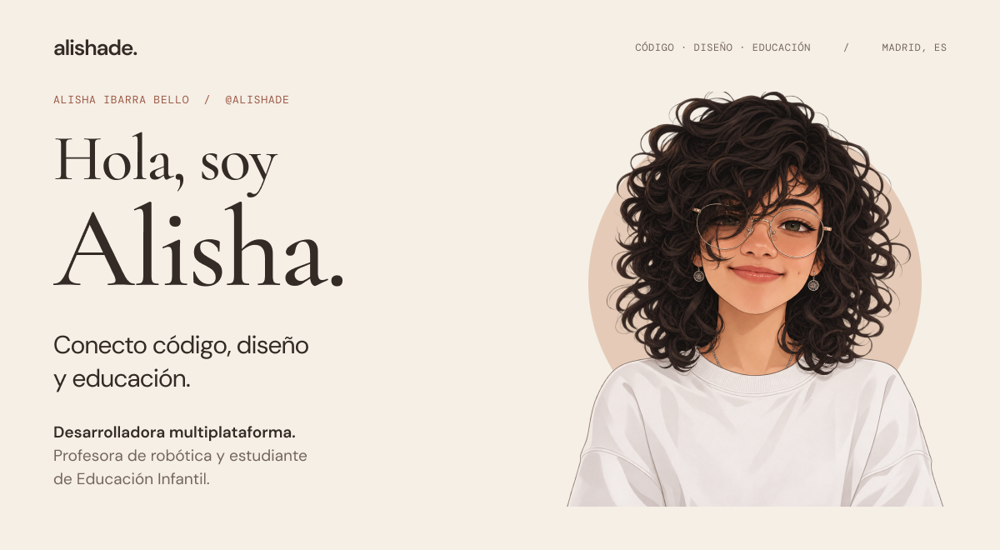
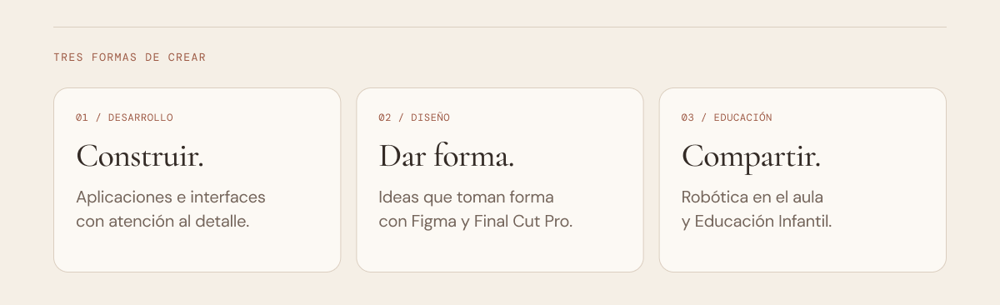
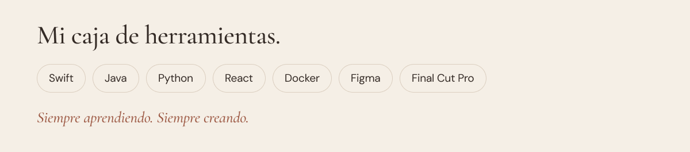

  

  <a href="mailto:alishaibarra@alishade.studio"><strong>Hablemos ↗</strong></a>
  &nbsp; · &nbsp;
  <a href="https://github.com/alishade?tab=repositories"><strong>Explora mis repositorios ↗</strong></a>

  Me interesa crear aplicaciones, dar forma a ideas y compartir lo que aprendo.

  

  

<strong>Leer mi perfil en texto</strong>

### Hola, soy Alisha

Soy **Alisha Ibarra Bello**, también conocida como **Alishade**. Soy desarrolladora multiplataforma, profesora de robótica y estudiante de Educación Infantil en Madrid.

Me interesa conectar el código, el diseño y la educación: crear aplicaciones, dar forma a ideas y compartir lo que aprendo.

### Tres formas de crear

- **Construir.** Aplicaciones e interfaces con atención al detalle.
- **Dar forma.** Ideas que toman forma con Figma y Final Cut Pro.
- **Compartir.** Robótica en el aula y Educación Infantil.

### Mi caja de herramientas

| Área | Tecnologías y herramientas |
| --- | --- |
| Lenguajes | Swift · Java · Python |
| Interfaces | React |
| Contenedores | Docker |
| Diseño | Figma |
| Edición de vídeo | Final Cut Pro |

*Siempre aprendiendo. Siempre creando.*

**Contacto:** [alishaibarra@alishade.studio](mailto:alishaibarra@alishade.studio)

**Repositorios:** [github.com/alishade](https://github.com/alishade?tab=repositories)

