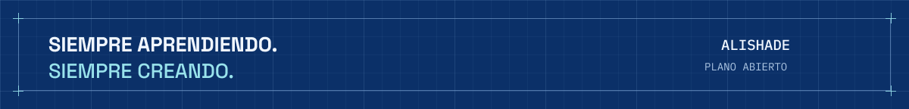

  

  <a href="#perfil">Perfil</a> &nbsp; / &nbsp;
  <a href="#stack">Stack</a> &nbsp; / &nbsp;
  <a href="#areas">Áreas de trabajo</a> &nbsp; / &nbsp;
  <a href="#contacto">Contacto</a>

## 01 / Perfil

Soy **Alisha Ibarra Bello**, también conocida como **Alishade**. Soy desarrolladora multiplataforma, profesora de robótica y estudiante de Educación Infantil en Madrid.

Mi punto de encuentro está entre el **código, el diseño y la educación**: crear aplicaciones, dar forma a ideas y compartir lo que aprendo.

## 02 / Stack

  

| Área | Tecnologías y herramientas |
| :--- | :--- |
| Lenguajes | **Swift** · **Java** · **Python** |
| Interfaces | **React** |
| Contenedores | **Docker** |
| Diseño | **Figma** |
| Edición de vídeo | **Final Cut Pro** |

## 03 / Áreas de trabajo

- **Desarrollo · Construir.** Aplicaciones e interfaces con atención al detalle.
- **Diseño · Dar forma.** Ideas que toman forma con Figma y Final Cut Pro.
- **Educación · Compartir.** Robótica en el aula y aprendizaje en Educación Infantil.

## 04 / Explora y conecta

Los proyectos y el código están en [mis repositorios de GitHub](https://github.com/alishade?tab=repositories).

Si quieres hablar sobre una idea, puedes escribirme a **[alishaibarra@alishade.studio](mailto:alishaibarra@alishade.studio)**.

  

